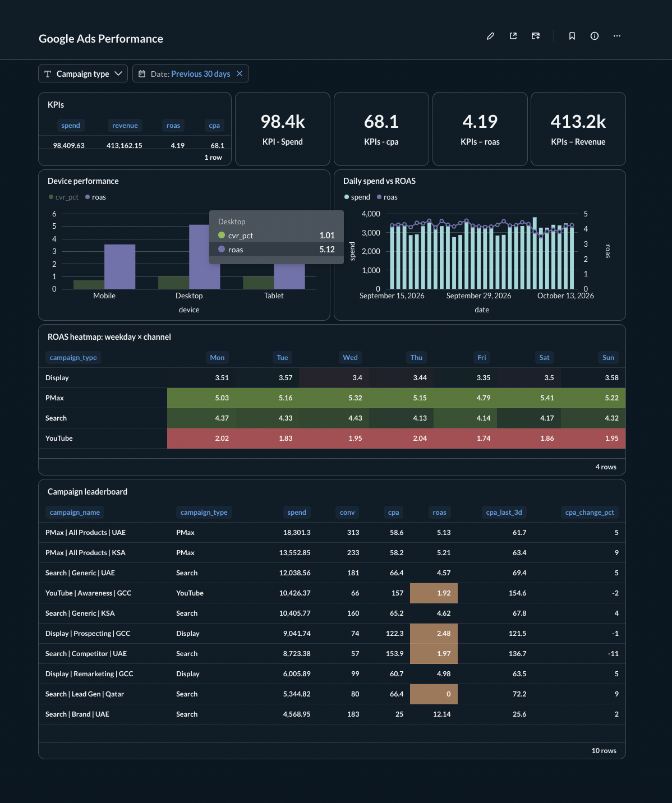
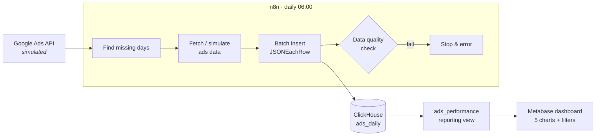
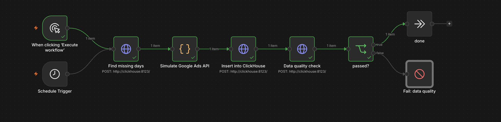

# Marketing Analytics Pipeline: n8n → ClickHouse → Metabase

An automated Google Ads reporting pipeline. **n8n** loads daily ad performance into **ClickHouse**, with gap backfill and a data-quality gate, and **Metabase** dashboards surface ROAS, CPA trends and anomalies.

**Result:** the analysis found 3 budget leaks worth about **+240 conversions/month (+17%) at the same spend**. See the [insights memo](docs/insights-memo.md).

> Data is synthetic (one year, 10 GCC campaigns, about 33k rows), generated to realistic benchmarks with planted issues to detect. Swapping in the real Google Ads API means replacing one n8n node.



## Architecture





## What it demonstrates

| Area | Detail |
|---|---|
| **Data modelling** | `ReplacingMergeTree` with monthly partitions; idempotent reloads deduplicated via `FINAL`; a denormalised reporting view so BI tools need no joins |
| **Pipeline engineering** | Gap detection backfills any missed days (up to 30); single batched insert; automatic data-quality gate (row counts, impossible values) that fails the run loudly |
| **Security** | Separate least-privilege ClickHouse users: read-only for Metabase, select/insert for n8n |
| **BI** | Metabase SQL questions with field filters (date range, campaign type) wired to dashboard filters; conditional formatting; heatmap |
| **Analysis** | Campaign efficiency, anomaly detection, device conversion gap, weekday (null) finding, with AED-quantified recommendations |
| **ClickHouse SQL** | `sumIf` / `countIf` conditional aggregates, scalar `WITH`, `toDayOfWeek`, `cityHash64`-based deterministic data generation |

## Key findings

| # | Finding | Recommendation | Impact |
|---|---|---|---|
| 1 | Competitor Search CPA AED 154, against 66 for Generic Search | Reallocate to PMax | ~+90 conv/month |
| 2 | 3-day CPC spike (2.8×) went unnoticed, AED 1.1k excess | Automated anomaly alert | Detect on day 1 |
| 3 | Mobile CVR 30% below desktop on 59% of spend | Landing-page audit and bid adjustment | ~+150 conv/month |

Full write-up: [docs/insights-memo.md](docs/insights-memo.md)

## Repo structure

```
├── docker-compose.yml          # n8n, ClickHouse 26.3 LTS, Metabase
├── .env.example                # credentials template
├── sql/
│   ├── 01_ads_schema_and_seed.sql   # tables + 1 year of synthetic data
│   └── 02_reporting_view.sql        # BI-facing view
├── workflows/
│   └── ads-clickhouse-daily-loader.json   # import into n8n
├── metabase/questions/         # SQL behind each dashboard card
├── scripts/
│   ├── bootstrap.sh            # create users, schema, data
│   └── export-workflows.sh     # export n8n workflows without personal data
└── docs/
    ├── insights-memo.md
    ├── operations.md           # start/stop/update/backup
    └── screenshots/
```

## Run it locally

Requires Docker Desktop.

```bash
cp .env.example .env            # then set passwords
docker compose up -d            # n8n :5678 · Metabase :3000 · ClickHouse :8123
./scripts/bootstrap.sh          # users, schema, synthetic data, view
```

1. **n8n** (http://localhost:5678): import `workflows/ads-clickhouse-daily-loader.json`, then create a Basic Auth credential with `N8N_CH_USER` / `N8N_CH_PASSWORD`.
2. **Metabase** (http://localhost:3000): add a ClickHouse database with host `clickhouse`, port `8123`, database `analytics`, user `METABASE_CH_USER`. Recreate the cards from `metabase/questions/`.

## Notes
- ClickHouse is pinned to **26.3 LTS**: `latest` (26.9) breaks the JDBC driver bundled with Metabase 0.64 (`Invalid LZ4 magic byte`).
- Next: an AI anomaly-alert workflow (n8n + Claude), building on finding #2.
